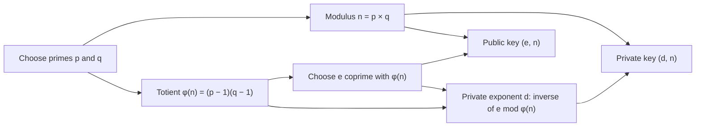

# RSA Foundations for Learners

RSA is a public-key cryptosystem named after Ron Rivest, Adi Shamir, and Leonard Adleman. It is historically important because it showed how two people can communicate securely without first sharing the same secret key in person.

This guide explains the ideas demonstrated by RSA Learning Lab. The application intentionally exposes the arithmetic so learners can see how a key pair is created and how a message becomes a number, ciphertext, and readable text again.

> [!IMPORTANT]
> RSA Learning Lab demonstrates textbook RSA for education. It does not implement the padding, randomness, key handling, authenticated protocols, or hardened libraries required for production cryptography. Do not use it to protect real secrets.

## How to read this guide

Everyone arrives with a different level of comfort with mathematics. This guide is written in layers, so you can stop at the depth that suits you and come back later for more.

Every equation uses the same layout:

| Layer | What it gives you |
| --- | --- |
| **In plain words** | The idea in one sentence, without symbols |
| **The formula** | The equation itself |
| **Read aloud** | How to say the formula, which helps if the symbols are unfamiliar or you use a screen reader |
| **With the example numbers** | The formula filled in with the small numbers from the [worked example](#worked-example) |
| **Go deeper** | A collapsible section with the reasoning, proofs, and production details |

Choose a reading path:

- **New to the math:** start with the [symbol glossary](#symbol-glossary) and [The math you need](#math-you-need). For each equation, read the plain words, the read-aloud line, and the example numbers, and skip "Go deeper" for now. Then follow the [worked example](#worked-example) alongside the app.
- **Comfortable with algebra:** skim [The math you need](#math-you-need), then focus on the formulas in [Key generation](#key-generation) and [Encryption and decryption](#encryption-and-decryption). Try the [worked example](#worked-example) by hand before opening its derivations.
- **Want the proofs:** open every "Go deeper" section, read [Why decryption works](#why-decryption-works), and continue with RFC 8017 in [Further reading](#further-reading).

## Symbol glossary

| Symbol | In plain words | Public or private? | In the worked example |
| --- | --- | --- | --- |
| $p$, $q$ | Two secret prime numbers chosen at the start | Private | $p = 61$, $q = 53$ |
| $n$ | The modulus: the product of $p$ and $q$ | Public | $3233$ |
| $\varphi(n)$ | Euler's totient of $n$ ("phi of n"), which links the two exponents | Private | $3120$ |
| $e$ | The public exponent, used to encrypt | Public | $17$ |
| $d$ | The private exponent, used to decrypt | Private | $2753$ |
| $m$ | The message, written as a whole number | Private (it is the secret being protected) | $65$, the letter "A" |
| $c$ | The ciphertext: the encrypted number | Public (safe to send) | $2790$ |
| $a \bmod n$ | The remainder after dividing $a$ by $n$ | Operation | $17 \bmod 5 = 2$ |
| $\gcd(a, b)$ | The greatest common divisor: the largest number that divides both | Operation | $\gcd(17, 3120) = 1$ |
| $a \equiv b \pmod{n}$ | "$a$ and $b$ leave the same remainder when divided by $n$" | Relation | $26 \equiv 2 \pmod{12}$ |

## 1. Why asymmetric encryption matters

### The key-distribution problem

Symmetric encryption uses one shared secret key for both encryption and decryption. It is fast and well suited to protecting large amounts of data, but it creates an important question:

**How can two people agree on a secret key when an attacker may be watching the network?**

Asymmetric cryptography changes the model. Each participant has a mathematically related pair of keys:

- A **public key** that may be distributed openly.
- A **private key** that must remain secret.

Knowing the public key lets someone perform the public operation, but it should not make the corresponding private operation practical to compute.

### Two different security goals

Public-key cryptography supports two related but different workflows:

1. **Confidentiality:** Encrypt with the recipient's public key; decrypt with the recipient's private key.
2. **Authenticity and integrity:** Sign with the sender's private key; verify with the sender's public key.

A digital signature does not hide the message. It helps a verifier determine whether the signed data came from the private-key holder and whether it changed after signing.

### Real systems are usually hybrid

RSA is computationally expensive and can process only messages smaller than its modulus after encoding. Real protocols therefore do not normally use RSA to encrypt an entire file, video, or network session.

Instead, systems combine:

- **Asymmetric cryptography** to establish trust, authenticate a party, or protect a small secret.
- **Symmetric cryptography** to encrypt the actual application data efficiently.

This is called **hybrid encryption**. It explains why asymmetric encryption matters even though symmetric algorithms perform most bulk encryption.

## 2. The RSA idea

RSA uses modular arithmetic and a pair of inverse exponent operations. Its one-way advantage comes from an asymmetry:

- Multiplying two large primes is easy.
- Recovering those primes from their product is believed to be impractical when the primes and implementation are chosen correctly and the modulus is sufficiently large.

The product of the primes is public, but the prime factors are secret.

## 3. The math you need

RSA needs only four ideas from number theory. Each one is short; if you already know them, skip ahead to [Key generation](#key-generation).

### Prime numbers

**In plain words:** a prime is a whole number greater than 1 that can be divided evenly only by 1 and itself.

$$
p \text{ is prime} \iff \text{its only positive divisors are } 1 \text{ and } p
$$

**Read aloud:** "p is prime exactly when its only positive divisors are one and p."

**With the example numbers:** $61$ and $53$ are prime. $51$ is not, because $51 = 3 \times 17$.

Go deeper

Every whole number greater than 1 factors into primes in exactly one way (the fundamental theorem of arithmetic). RSA relies on the fact that multiplying primes is fast, while finding the prime factors of a large product is believed to be impractical.

The Learning Lab checks primality with SymPy's `isprime` and generates example primes by drawing random bit strings with Python's `random` module until one is prime. That is fine for a demonstration but not for real keys; see [What production RSA adds](#production-rsa).

### Modular arithmetic

**In plain words:** "mod" means "keep only the remainder." It works like a clock, where counting past 12 wraps back around to the start.

$$
a \bmod n = \text{the remainder when } a \text{ is divided by } n
$$

$$
a \equiv b \pmod{n} \quad \text{means} \quad a \bmod n = b \bmod n
$$

**Read aloud:** "a mod n is the remainder of a divided by n," and "a is congruent to b, mod n."

**With the example numbers:** five hours after 9 o'clock is 2 o'clock, so $(9 + 5) \bmod 12 = 2$. Likewise $17 \bmod 5 = 2$, and $26 \equiv 2 \pmod{12}$ because both leave a remainder of 2.

Go deeper

You can reduce at any step without changing the final remainder:

$$
(a \times b) \bmod n = \big((a \bmod n) \times (b \bmod n)\big) \bmod n
$$

This is why a computer can calculate $m^e \bmod n$ without ever storing the enormous number $m^e$. The [square-and-multiply walkthrough](#square-and-multiply) in the worked example shows it step by step.

### Greatest common divisor and coprime numbers

**In plain words:** the greatest common divisor is the largest number that divides two numbers evenly. Two numbers are coprime when that divisor is just 1, meaning they share no factors.

$$
\gcd(a, b) = 1 \iff a \text{ and } b \text{ are coprime}
$$

**Read aloud:** "the G C D of a and b equals one exactly when a and b are coprime."

**With the example numbers:** $\gcd(17, 3120) = 1$, so 17 and 3120 are coprime. $\gcd(15, 3120) = 15$, so 15 and 3120 are not.

Go deeper

The Euclidean algorithm finds the GCD by repeated division: replace the pair $(a, b)$ with $(b, a \bmod b)$ until the remainder is 0. The last non-zero remainder is the GCD. The [extended Euclidean table](#extended-euclidean) in the worked example runs this algorithm on $3120$ and $17$.

### Modular inverses

**In plain words:** a modular inverse "undoes" multiplication in mod arithmetic. It is the number you multiply by to get back to 1.

$$
a \times a^{-1} \equiv 1 \pmod{n}
$$

**Read aloud:** "a times a-inverse is congruent to one, mod n."

**With the example numbers:** mod 7, the inverse of 3 is 5, because $3 \times 5 = 15$ and $15 \equiv 1 \pmod{7}$.

Go deeper

An inverse of $a$ modulo $n$ exists exactly when $\gcd(a, n) = 1$. If $a$ and $n$ shared a factor $g > 1$, every value of $(a \times x) \bmod n$ would also be a multiple of $g$, so it could never equal 1. This is why RSA requires $e$ to be coprime with $\varphi(n)$: otherwise the private exponent $d$ would not exist.

## 4. Key generation

RSA key generation begins with two distinct prime numbers, $p$ and $q$. Every other value is calculated from them:

### Step 1: Compute the modulus

**In plain words:** multiply the two primes together. The result is shared publicly and sets the size of the numbers RSA works with.

$$
n = p \times q
$$

**Read aloud:** "n equals p times q."

**With the example numbers:** $n = 61 \times 53 = 3233$

Go deeper

The modulus is part of both keys. Publishing $n$ is safe only because recovering $p$ and $q$ from it (factoring) is believed to be impractical when $n$ is large enough. The size of $n$ in bits is roughly the sum of the sizes of $p$ and $q$: the example's $n = 3233$ is 12 bits, while the Learning Lab's default 512-bit primes give a modulus of about 1024 bits.

### Step 2: Compute Euler's totient

**In plain words:** count how many whole numbers from 1 to $n$ share no factor with $n$. For a product of two primes, there is a shortcut.

$$
\varphi(n) = (p - 1)(q - 1)
$$

**Read aloud:** "phi of n equals p minus one, times q minus one."

**With the example numbers:** $\varphi(3233) = 60 \times 52 = 3120$

Go deeper

Of the numbers $1$ to $n$, the only ones that share a factor with $n = pq$ are the multiples of $p$ (there are $q$ of them) and the multiples of $q$ (there are $p$ of them), with $n$ itself counted in both lists. So:

$$
\varphi(pq) = pq - q - p + 1 = (p - 1)(q - 1)
$$

For the example: $3233 - 53 - 61 + 1 = 3120$.

$\varphi(n)$ must stay secret, because anyone who knows it can calculate $d$ exactly as the key owner does.

RFC 8017 also allows the smaller Carmichael function $\lambda(n) = \operatorname{lcm}(p - 1, q - 1)$ in place of $\varphi(n)$. For the example, $\lambda(3233) = 780$, which gives a smaller private exponent $d = 413$ that decrypts just as well. The Learning Lab uses $\varphi(n)$.

### Step 3: Select the public exponent

**In plain words:** pick the encryption exponent $e$. It must share no factors with $\varphi(n)$; otherwise, decryption is impossible.

$$
1 < e < \varphi(n) \qquad \gcd(e, \varphi(n)) = 1
$$

**Read aloud:** "e is between one and phi of n, and the G C D of e and phi of n is one."

**With the example numbers:** $e = 17$ works, because $\gcd(17, 3120) = 1$.

Go deeper

The coprime condition guarantees that $e$ has an inverse modulo $\varphi(n)$ (see [Modular inverses](#math-inverse)), and that inverse becomes the private exponent.

A common choice is $e = 65537 = 2^{16} + 1$, which is the Learning Lab's default. In binary it is a 1, then fifteen 0s, then another 1, so encrypting takes only 16 squarings and one multiplication. It is also prime, so it is coprime with $\varphi(n)$ unless it divides $\varphi(n)$. The worked example uses $e = 17$ because 65537 is larger than its tiny $\varphi(n) = 3120$.

### Step 4: Compute the private exponent

**In plain words:** find the number $d$ that "undoes" $e$. Multiplying them together gives 1 in mod $\varphi(n)$ arithmetic.

$$
e \times d \equiv 1 \pmod{\varphi(n)}
$$

**Read aloud:** "e times d is congruent to one, mod phi of n."

**With the example numbers:** $d = 2753$, because $17 \times 2753 = 46801 = 15 \times 3120 + 1$.

Go deeper

$d$ is the [modular inverse](#math-inverse) of $e$, found with the extended Euclidean algorithm. The Learning Lab's backend does this in `find_mod_inverse`, and the [extended Euclidean table](#extended-euclidean) in the worked example shows each step for $e = 17$.

Equivalently, $e \times d = 1 + k\,\varphi(n)$ for some whole number $k$ (here $k = 15$). That form is the key to [why decryption works](#why-decryption-works).

### Step 5: Form the key pair

**In plain words:** the public key is what you share so that others can encrypt messages to you. The private key is what you keep so that only you can decrypt them.

$$
\text{Public key} = (e, n) \qquad \text{Private key} = (d, n)
$$

**Read aloud:** "the public key is e and n; the private key is d and n."

**With the example numbers:** the public key is $(17, 3233)$ and the private key is $(2753, 3233)$.

Go deeper

Besides $d$, the values $p$, $q$, and $\varphi(n)$ must stay secret too, because any one of them is enough to recalculate $d$. Production private keys usually store $p$, $q$, and a few derived values anyway, because they allow faster decryption using the Chinese remainder theorem.

## 5. Encryption and decryption

### The message must fit inside the modulus

**In plain words:** before encrypting, the text is turned into a single whole number. That number has to be smaller than $n$.

$$
0 \le m < n
$$

**Read aloud:** "m is at least zero and less than n."

**With the example numbers:** the letter "A" is 65 in ASCII, so $m = 65$, which is less than $3233$.

Go deeper

The Learning Lab encodes text by writing each ASCII character as one byte and reading the bytes as one large number. "Hi" becomes $72 \times 256 + 105 = 18537$, which is already too large for the example's $n = 3233$, so the tiny example key can hold only one character.

All RSA arithmetic happens mod $n$, so a message $m \ge n$ would wrap around and decrypt to $m \bmod n$ instead of $m$. The backend rejects such messages. With the default modulus of about 1024 bits, the limit is roughly 127 ASCII characters, sometimes fewer.

### Encrypt with the public key

**In plain words:** raise the message number to the power $e$, then keep only the remainder after dividing by $n$.

$$
c = m^e \bmod n
$$

**Read aloud:** "c equals m to the power e, mod n."

**With the example numbers:** $c = 65^{17} \bmod 3233 = 2790$

Go deeper

$65^{17}$ has 31 digits, and real messages and exponents are far larger, but reducing mod $n$ after every step keeps the numbers small. The [square-and-multiply walkthrough](#square-and-multiply) shows how.

Textbook RSA is deterministic: the same $m$ and public key always produce the same $c$, which leaks information. Production RSA adds randomized padding (RSAES-OAEP) before encrypting.

### Decrypt with the private key

**In plain words:** do the same thing with the private exponent $d$, and the original message number comes back.

$$
m = c^d \bmod n
$$

**Read aloud:** "m equals c to the power d, mod n."

**With the example numbers:** $m = 2790^{2753} \bmod 3233 = 65$, which decodes back to "A".

Go deeper

Decryption works because $e$ and $d$ were chosen as inverses mod $\varphi(n)$, so raising to the power $e$ and then to the power $d$ brings every valid message back to itself. The next section explains why.

### Why decryption works

Show the reasoning (uses Euler's theorem)

Decrypting an encrypted message computes:

$$
c^d \equiv (m^e)^d = m^{ed} \pmod{n}
$$

From [Step 4](#eq-private-exponent), $ed = 1 + k\,\varphi(n)$ for some whole number $k$, so:

$$
m^{ed} = m^{1 + k\varphi(n)} = m \times \left(m^{\varphi(n)}\right)^k
$$

**Euler's theorem** says that if $\gcd(m, n) = 1$, then $m^{\varphi(n)} \equiv 1 \pmod{n}$. Substituting:

$$
m^{ed} \equiv m \times 1^k = m \pmod{n}
$$

Because $0 \le m < n$, the remainder is exactly $m$: the original message.

**What if $m$ shares a factor with $n$?** The argument above needs $\gcd(m, n) = 1$, but the result holds for every $0 \le m < n$. Check the congruence separately mod $p$ and mod $q$ using Fermat's little theorem (it holds trivially when $p$ or $q$ divides $m$), then combine the two results with the Chinese remainder theorem. RFC 8017 gives the full specification.

## 6. Worked example

Small values are insecure but make the arithmetic visible. Every number below can be checked by hand or with a calculator.

$$
\begin{aligned}
p &= 61, \quad q = 53 \\
n &= 61 \times 53 = 3233 \\
\varphi(n) &= 60 \times 52 = 3120 \\
e &= 17 \\
d &= 2753, \quad \text{because } 17 \times 2753 \equiv 1 \pmod{3120}
\end{aligned}
$$

For the message "A", encoded as $m = 65$:

$$
\begin{aligned}
\text{Encrypt:} \quad c &= 65^{17} \bmod 3233 = 2790 \\
\text{Decrypt:} \quad m &= 2790^{2753} \bmod 3233 = 65
\end{aligned}
$$

The example demonstrates reversibility for the key holder. It does not demonstrate real-world security because the primes are tiny and no secure encoding or padding is used.

Finding d with the extended Euclidean algorithm

First, run the Euclidean algorithm on $\varphi(n) = 3120$ and $e = 17$, dividing until the remainder is 0:

| Division | Quotient | Remainder |
| --- | --- | --- |
| $3120 = 183 \times 17 + 9$ | 183 | 9 |
| $17 = 1 \times 9 + 8$ | 1 | 8 |
| $9 = 1 \times 8 + 1$ | 1 | 1 |
| $8 = 8 \times 1 + 0$ | 8 | 0 |

The last non-zero remainder is 1, which confirms $\gcd(17, 3120) = 1$. Now work backwards, writing 1 in terms of 3120 and 17:

$$
\begin{aligned}
1 &= 9 - 1 \times 8 \\
  &= 9 - 1 \times (17 - 1 \times 9) = 2 \times 9 - 17 \\
  &= 2 \times (3120 - 183 \times 17) - 17 = 2 \times 3120 - 367 \times 17
\end{aligned}
$$

So $17 \times (-367) \equiv 1 \pmod{3120}$. Adding 3120 gives the positive value:

$$
d = -367 + 3120 = 2753
$$

Computing the ciphertext with square-and-multiply

Write the exponent as a sum of powers of 2: $17 = 16 + 1$, so $65^{17} = 65^{16} \times 65$. Get $65^{16}$ by squaring four times, reducing mod 3233 after each step:

| Power | Calculation | Result mod 3233 |
| --- | --- | --- |
| $65^1$ | Starting value | 65 |
| $65^2$ | $65^2 = 4225$ | 992 |
| $65^4$ | $992^2 = 984064$ | 1232 |
| $65^8$ | $1232^2 = 1517824$ | 1547 |
| $65^{16}$ | $1547^2 = 2393209$ | 789 |
| $65^{17}$ | $789 \times 65 = 51285$ | **2790** |

The largest number in the whole calculation is about 2.4 million, instead of the 31-digit value of $65^{17}$. Decryption uses the same method: $2753$ is 12 bits long in binary with five 1 bits, so it takes 11 squarings and 4 multiplications.

## 7. How RSA Learning Lab maps to the algorithm

| Learning Lab action | RSA concept |
| --- | --- |
| Choose or generate $p$ and $q$ | Select two secret [primes](#math-primes) |
| Enter the public exponent | Choose $e$ coprime with $\varphi(n)$ ([Step 3](#eq-public-exponent)) |
| Submit key data | Calculate $n$, $\varphi(n)$, and private exponent $d$ ([Steps 1](#eq-modulus), [2](#eq-totient), and [4](#eq-private-exponent)) |
| Encrypt text | Convert ASCII text to integer $m$ ([message range](#eq-message-range)), then calculate $c = m^e \bmod n$ ([encrypt](#eq-encrypt)) |
| Copy encrypted output | Observe ciphertext $c$ represented as a decimal integer |
| Decrypt the integer | Calculate $m = c^d \bmod n$, then decode the result as ASCII ([decrypt](#eq-decrypt)) |
| Change prime bit lengths | Observe how the modulus size affects message capacity ([message range](#eq-message-range)) and computation |

The application requires the encoded message integer to be smaller than $n$. A longer message may therefore fail even when its character count seems small.

## 8. What production RSA adds

Textbook RSA is deterministic: the same message and public key produce the same ciphertext. That leaks information and enables practical attacks. Secure RSA encryption uses a standardized randomized encoding such as **RSAES-OAEP**. Secure RSA signatures use a signature encoding such as **RSASSA-PSS**.

Production systems also require:

- Cryptographically secure random-number generation.
- Approved modulus sizes and parameter validation.
- Constant-time or otherwise side-channel-resistant implementations.
- Secure private-key generation, storage, rotation, and destruction.
- Authenticated protocols that bind keys to identities.
- Carefully reviewed cryptographic libraries rather than handwritten primitives.

### Current limitations of this application

The current Learning Lab:

- Performs raw modular exponentiation without OAEP or PSS.
- Converts ASCII text directly to an integer instead of using a production encoding scheme.
- Uses Python's general-purpose `random` module when generating example primes.
- Defaults to two 512-bit prime candidates, producing a modulus of approximately 1024 bits rather than a production-strength RSA modulus.
- Demonstrates encryption/decryption but does not yet demonstrate signatures, certificates, or hybrid session-key establishment.

These limitations make the internal steps easier to inspect, but they also mean the application is educational only.

## 9. RSA's role today

RSA remains important for understanding public-key cryptography and is still encountered in:

- Digital signatures and code-signing systems.
- Public-key certificates and public-key infrastructure.
- Existing secure-email, VPN, enterprise, and embedded systems.
- Legacy TLS deployments and historical explanations of key transport.

Modern TLS normally establishes session secrets with ephemeral Diffie–Hellman variants rather than directly encrypting a session key with RSA. RSA certificates and signatures may still appear, depending on the configuration and protocol version.

For U.S. federal standards, NIST's 2026 transition plan marks classical 112-bit-strength schemes, including RSA with a 2048-bit modulus in the covered uses, as deprecated after 2030 and disallowed after 2035. Some federal transitions have earlier deadlines. These dates are migration policy milestones, not predictions that every RSA key becomes mathematically breakable on a particular day.

NIST's post-quantum standards separate RSA's former roles:

- **ML-KEM** provides post-quantum key establishment.
- **ML-DSA** and **SLH-DSA** provide post-quantum digital signatures.

They should be understood as role-specific successors rather than one universal drop-in replacement named "the new RSA."

## 10. Questions to test your understanding

Try to answer each question before opening its answer.

**1. Why is distributing a symmetric secret key difficult over an untrusted network?**

Answer

Anyone watching the network could copy the key while it is being sent and then decrypt everything protected by it. Without public-key cryptography, the two parties would first need a separate secure channel, such as meeting in person, to share the key.

**2. Which RSA values are public, and which values must remain private?**

Answer

Public: the modulus $n$, the public exponent $e$, and the ciphertext $c$. Private: the private exponent $d$ and the plaintext $m$, plus $p$, $q$, and $\varphi(n)$, because any one of those three is enough to recalculate $d$. See the [symbol glossary](#symbol-glossary).

**3. Why must $e$ be coprime with $\varphi(n)$?**

Answer

Only then does $e$ have an inverse modulo $\varphi(n)$. That inverse is the private exponent $d$; without it, there is no way to reverse encryption. See [Modular inverses](#math-inverse) and [Step 3](#eq-public-exponent).

**4. Why must the encoded message integer be smaller than $n$?**

Answer

All RSA arithmetic is done mod $n$, so any message $m \ge n$ wraps around. Decryption would return $m \bmod n$ instead of the original message. See [The message must fit inside the modulus](#eq-message-range).

**5. Why is textbook RSA unsafe even when the modulus is large?**

Answer

It has no randomness or padding. The same message always produces the same ciphertext, so an attacker can confirm guesses by encrypting candidates with the public key. Ciphertexts can be combined: multiplying two ciphertexts produces a valid encryption of the product of their messages. With a small exponent such as $e = 3$, a short message may satisfy $m^e < n$, so the "encryption" never wraps around and an ordinary cube root recovers $m$. Padding schemes such as RSAES-OAEP prevent these attacks.

**6. Why do real systems combine asymmetric and symmetric cryptography?**

Answer

RSA is slow and can encrypt only messages smaller than $n$, while symmetric ciphers are fast and handle data of any size. Real systems use asymmetric cryptography to authenticate parties and establish a small shared secret, then use a symmetric cipher with that secret for the actual data.

**7. How is encryption different from a digital signature?**

Answer

Encryption uses the recipient's public key and hides the message, so only the private-key holder can read it. A signature uses the sender's private key and does not hide anything; it lets anyone with the public key check who signed the data and that it has not changed since.

**8. Why does post-quantum migration require separate standards for key establishment and signatures?**

Answer

RSA can perform both jobs, but its post-quantum successors are specialized: ML-KEM handles key establishment, while ML-DSA and SLH-DSA handle signatures. Each role therefore has to be migrated to its own replacement. See [RSA's role today](#rsa-role-today).

## 11. Further reading

- NIST, *FIPS 186-5: Digital Signature Standard*: https://doi.org/10.6028/NIST.FIPS.186-5
- NIST, *SP 800-56B Rev. 2: Recommendation for Pair-Wise Key-Establishment Schemes Using Integer Factorization Cryptography*: https://doi.org/10.6028/NIST.SP.800-56Br2
- NIST, *IR 8547: Transition to Post-Quantum Cryptography Standards* (final, 2026): https://doi.org/10.6028/NIST.IR.8547
- IETF, *RFC 8017: PKCS #1 v2.2 — RSA Cryptography Specifications*: https://www.rfc-editor.org/rfc/rfc8017
- NIST, *FIPS 203: Module-Lattice-Based Key-Encapsulation Mechanism Standard*: https://doi.org/10.6028/NIST.FIPS.203
- NIST, *FIPS 204: Module-Lattice-Based Digital Signature Standard*: https://doi.org/10.6028/NIST.FIPS.204
- NIST, *FIPS 205: Stateless Hash-Based Digital Signature Standard*: https://doi.org/10.6028/NIST.FIPS.205
